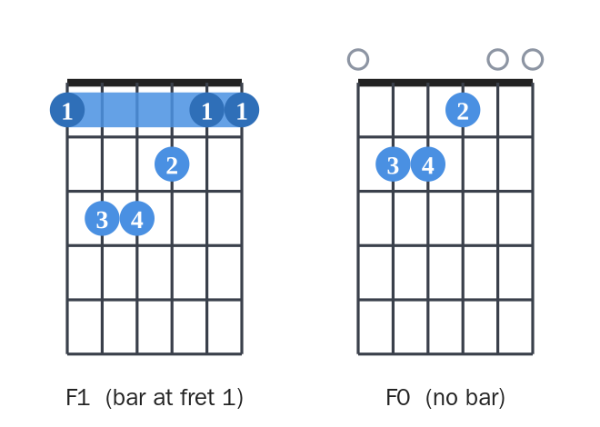
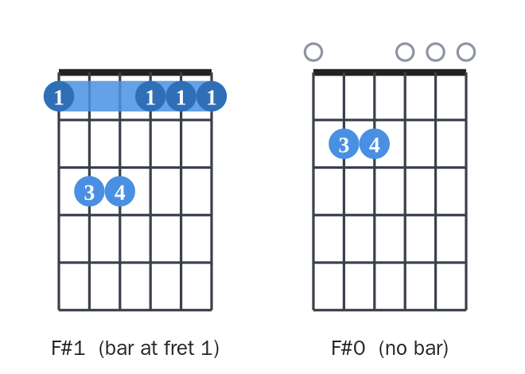
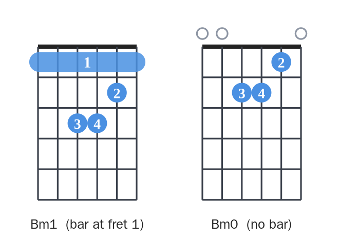
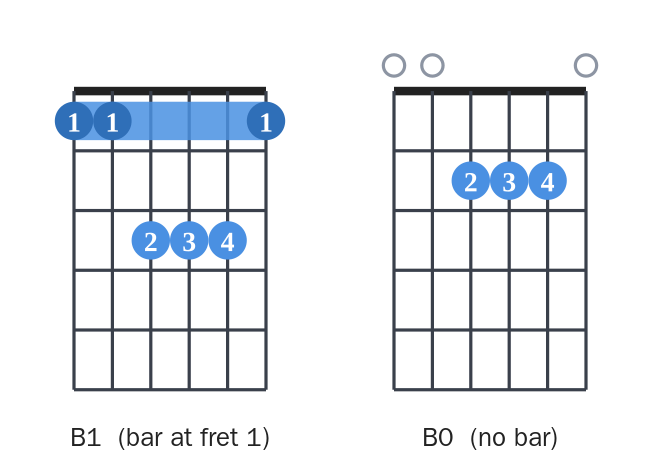

# Capo Chord Translator

A single-file web tool (`index.html`, no install, no server) that converts chord names into a custom **barre-shape + fret** notation, adjusted for any capo position. Open `index.html` in a browser, paste your notes, and copy the result.

The notation is a personal system created by the author, not a standard one. Note names are intentionally **not** the real chord names.

## How the translation works

Each chord has a rule written as `CHORD=SHAPE+FRETS`. The rule describes the chord **with the capo at 0**.

```
G=F+3     C=B+3     D=B+5     Dm=Bm+5
E=F+0     Em=F#+0   Am=Bm+0   A=B+0
```

With a capo, **add the capo number to the frets**:

```
output = SHAPE + (FRETS + CAPO)        (written without the plus sign)
```

Example, capo 4: `D = B+5` becomes **B9**. `Em = F#+0` becomes **F#4**. `G = F+3` becomes **F7**.

| Chord | Rule (capo 0) | Capo 4 output |
|-------|---------------|---------------|
| G  | F+3  | F7  |
| C  | B+3  | B7  |
| D  | B+5  | B9  |
| Dm | Bm+5 | Bm9 |
| E  | F+0  | F4  |
| Em | F#+0 | F#4 |
| Am | Bm+0 | Bm4 |
| A  | B+0  | B4  |
| Gm | F+3  | F7  |
| F#m | F#+1 | F#5 |
| Am7 | Bm+0 | Bm4 (same as Am) |

### Shapes with no number, and shapes with a number

A shape written without a number gets a default fret (capo 0):

| Written | Read as |
|---------|---------|
| `Bm` | `Bm2` |
| `B` | `B2` |
| `F` | `F1` |
| `F#` | `F#1` |

A shape written with a number is used as is, so `F3` is F at fret 3 and `Bm5` is Bm at fret 5. The capo is added to every number, so with Capo 4 `Bm` becomes `Bm6` and `F3` becomes `F7`.

A repeat marker can also be attached to a chord with an underscore. The underscore is replaced with a space. It can also stand alone with no number:

| Written | Result (Capo 4) |
|---------|-----------------|
| `Am_X2` | `Bm4 X2` |
| `D_X` | `B9 X` |
| `_X2` | `X2` |
| `X` | `X` |

### Capo line in the result

The capo is already added into the translated frets, so the `Capo:` line in the result is changed to `Capo: 0`. Other text on that line (like `Gain: 2`) is kept. This also means you can paste a translated note back in without the capo being added twice.

### Repeat markers

An `X` with a number (`X2`, `x3`, or `2X`) means repeat. It stays exactly as written and the chords on the same line still translate: `Am,D,G,Em,X2` with Capo 4 becomes `Bm4, B9, F7, F#4, X2`.

### Chords left alone

`A7` and `E7` are not translated. They stay exactly as written, and the capo does not change them. This is a line in the rules box: `KEEP A7 E7`. Add more chords to that line to leave them alone too.

### Shapes written with "On"

A shape can also be written with `On` (any capitalization: `On`, `ON`, `on`), like `FOn2`, `bON5` or `F#on3`. The `On` is dropped and the number is used as the fret: `FOn2` is read as `F2`, `F#on3` as `F#3`. If there is **no number** (`FOn`, `BmOn`), the fret is **0**, not the default above. The capo is added as usual.

| Written | Capo 0 | Capo 4 |
|---------|--------|--------|
| `FON2` | `F2` | `F6` |
| `bOn2` | `B2` | `B6` |
| `BmOn5` | `Bm5` | `Bm9` |
| `FOn` | `F0` | `F4` |
| `F` (no On) | `F1` | `F5` |

The rules are editable in the page. Add your own lines in the same `CHORD=SHAPE+FRETS` format.

## PWC (power chord) notation

`PWC(SHAPE/FRET)`, for example `PWC(B/8)`. A normal chord for 7-string guitars, played on the top string when on a 6-string. The shape can be F, F# or B. The tool checks and passes PWC tokens through; it has no conversion rule for them.

## The default note header (and what it means)

Every note starts with this header (`examples/default-header.txt`). The tool keeps it exactly as written. Only the `Capo:`, `Tuning:` and `Reverb/Slowed/Live` lines may change per song.

```
1=Top String Closest
6=Bottom String Furthest
(String / Note)
Capo: 0
Tuning: STAND
*=Fix or Finish
------------------------------
PWC=Power Chord
ST=Pick At Same Time
X=Repeat
-----------------------------
Reverb/Slowed/Live=-?
-----------------------------
```

| Line | Meaning |
|------|---------|
| `1=Top String Closest` | String 1 is the top string, the one closest to you. |
| `6=Bottom String Furthest` | String 6 is the bottom string, the furthest from you. |
| `(String / Note)` | Tab notes are written `(string/fret)`. `(2/5)` is string 2, note 5. |
| `Capo: N` | Capo position. The tool reads this number and adds it to every chord's frets. |
| `Tuning: STAND` | Tuning of the guitar (standard here). Change it if the song is tuned differently. |
| `*=Fix or Finish` | A `*` marks a part that still needs fixing or finishing. |
| `PWC=Power Chord` | PWC means power chord. |
| `ST=Pick At Same Time` | ST means pick those notes at the same time. |
| `X=Repeat` | X means repeat (for example `-X2-` is repeat twice). |
| `Reverb/Slowed/Live=-?` | Marks whether the version is reverb, slowed or live (fill in the dash). |

## Full dictionary header (optional)

The default header above is the one used unless you ask for more. For songs that need the full legend, pick **Full dictionary** in the "Header type" menu (`examples/full-dictionary-header.txt`). It adds a Gain and Pedal line, more markers, technique symbols, and a blank song layout (Intro, Verse, Pre-chorus, Chorus, Bridge/breakdown/SOLO, Outro) to fill in. Header lines are copied through unchanged, so only the chords are translated.

| Line | Meaning |
|------|---------|
| `Capo: ? Gain: ?` | Capo position (the tool reads the number) and the gain/distortion level. |
| `Pedal: ?` | Pedal or effect used. |
| `+=Update Chords` | Chords in that part still need updating. |
| `(Ŝ)=Fill Out Solo` | The solo still needs to be filled out. |
| `(III)Fill Out Info` | Song info still needs to be filled out. |
| `RB=Bend` | Bend the string. |
| `H=Hammer-on` | Hammer-on. |
| `PO=Pull-off` | Pull-off. |
| `SL=Slide` | Slide between notes. |
| `FP=Fast Pick` | Fast picking. |
| `S=Strum` | Strum. |
| `T=Tab / Pick` | Play as tab / pick note by note. |
| `W=Whammy Bar` | Use the whammy bar. |
| `M=Mute...` | Mute with the fretboard hand and hit with the picking hand. |
| `~=Vibrato` | Vibrato. |

`*`, `PWC`, `ST`, `X` and `Reverb/Slowed` mean the same as in the default header.

## Chord shapes (what they look like)

These four barre shapes, plus PWC, are the only chords in this system. A custom chord in a song still follows one of these shapes. Strings run 6 to 1 from left to right, and the numbers in the dots are the fingers.

**Number rule (all shapes):** the number after the shape is the fret the bar sits on: `F1` = bar at fret 1, `F3` = bar at fret 3, and so on. When the number is 0 (a +0 rule), remove the bar (finger 1) and just play the rest of the notes.

### F


### F#


### Bm


### B


PWC (power chord) diagram coming soon.

## Quick use

1. Copy your note.
2. Click **Paste, translate & copy**. (Or click the left box, press Ctrl+V, and it translates and copies automatically.)
3. Paste the result wherever you want it.

By default the copy is **bold** (rich text), so it pastes into Google Keep already bolded. Untick "Paste as bold (Google Keep)" to copy plain text instead. Keep has no font, size or color settings that a web page can set, so bold is the one setting this controls.

The translated note is a plain-text box, so the formatting copies exactly. If your browser blocks clipboard access, the result gets selected for you: press Ctrl+C.

## How the tool treats your text

- Chord lines (for example `Dm,A,Em,G`) are translated. Chords can be separated by spaces, commas, `|` or dashes.
- Everything else (header, section names like VERSE, solo tab lines) is copied through unchanged.
- If the text has a `Capo: N` line, that number is used. Otherwise the capo box is used, and the standard header is added if the checkbox is on.
- Chords with no rule are shown in red instead of guessed.
- Solo tab numbers like `(2/5)` are not changed.

## Example

`examples/example-input.txt` is a full note with capo 4 and `examples/example-output.txt` is the translation.

Input chords for the verse: `Dm,A,Em,G`  ->  Output: `Bm9, B4, F#4, F7`

## Self-check

The page includes a table that tests the original rules (capo 0). All should show PASS.
